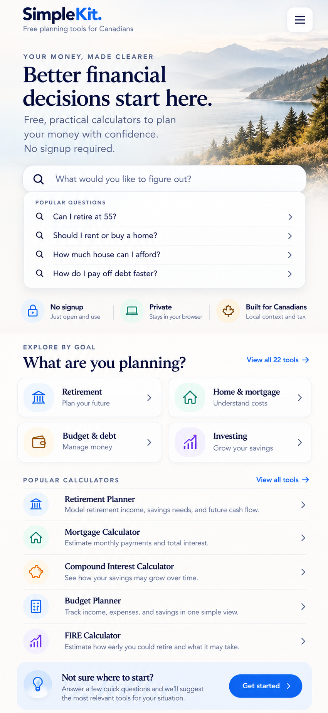

# SimpleKit v2 phased redesign implementation plan

Prepared: 2026-10-09. Repository: `ashleysnl/simplekit-site`.

This is an execution roadmap, not an implementation or release approval. All new tasks start incomplete. Implement one phase at a time on `develop-v2`, using a PR targeting `develop-v2` only when required, preserving all 22 calculators, their URLs, and production until the owner explicitly approves release.

## Git Branch Strategy — Mandatory

SimpleKit V2 uses a simplified development workflow.

### Permanent branches

* `main`: Stable production branch. Do not use for ongoing V2 development.
* `develop-v2`: The only persistent development branch for SimpleKit V2.

### Rules for all future Codex tasks

1. Always begin by checking out `develop-v2` and synchronizing with its latest remote state.
2. Implement all V2 tasks, fixes, refinements, SEO improvements, and documentation updates on `develop-v2`.
3. Do not create new persistent feature, phase, experiment, or Codex development branches.
4. Commit completed work directly to `develop-v2` when repository permissions and execution environment allow.
5. If Codex Cloud or GitHub requires a temporary task branch, create only the minimum necessary branch and merge it back into `develop-v2` as soon as the task passes validation.
6. Never leave completed work isolated on a temporary branch.
7. Before starting a new task, verify that previous completed changes have been integrated into `develop-v2`.
8. Do not merge V2 into `main` until the V2 release checklist and testing requirements have been satisfied.
9. Do not deploy V2 to the production website until explicitly authorized.
10. Treat `develop-v2` as the single source of truth for current V2 development.

### Standard Codex workflow

Checkout `develop-v2` → Sync → Implement coherent batch → Lightweight/focused checks → Update plan → Commit → Push\n\nComplete comprehensive QA against the finished release candidate in Phase 16.

If the environment requires a pull request, target `develop-v2`, not `main`.

Source-owned V2 work in SimpleKit-Core, RetirementPlanner, SimpleKITMortgageCalculator and subsequently migrated calculator repositories also targets each repository’s `develop-v2`. Their production `main` branches remain protected. Keep source pins reproducible and verify that pinned V2 commits are integrated into the owning repository’s `develop-v2` before continuing. See the [upstream integration record](v2/pr-integration-2026-10-11.md).

Start with a clean working tree, `git fetch origin`, `git switch develop-v2`, and `git pull --ff-only origin develop-v2`. If synchronization cannot fast-forward, inspect and preserve both histories; do not force-push or reset away work. Review outstanding PRs targeting `develop-v2` before beginning another task. Commit and push the plan update too so its handoff remains current.

### Release workflow

`develop-v2` → Final QA → Approved PR into `main` → Production deployment

After release, preserve `main` as the production source of truth and explicitly decide whether `develop-v2` is still required.

The [2026-10-09 branch audit and consolidation](v2/branch-consolidation-2026-10-09.md) records the inherited plan/Phase 0–4 history and archived branches. Those historical branches and PR references are evidence, not development destinations. Phase acceptance, unfinished checks, and release approval gates below remain in force.

The owner-authorized [2026-10-11 consolidation](v2/branch-consolidation-2026-10-11.md) integrates PR #13 and preserves cloud-native history in `develop-v2`. Earlier phase notes describing temporary PR #13 as unmerged are historical; their phase states and outstanding acceptance checks are unchanged. Continue V2 work on `develop-v2`. Remote feature-branch deletion is blocked by unavailable webhook dependency inspection; retaining those refs does not make them development destinations. No production release is authorized.

## Task state convention

| State | Meaning | Transition rule |
| --- | --- | --- |
| `[ ]` | Incomplete | Default for every new task and acceptance check. |
| `[~]` | In progress | Work has actually begun; record the branch/PR and remaining work. |
| `[x]` | Complete | Acceptance criteria passed and evidence is linked. |

Use literal `- [~]` for work in progress; GitHub may display it as text rather than a native checkbox. A blocked task stays `[ ]` or `[~]` with a written blocker. Do not mark implementation complete because this plan or its reference image was committed. Phase status becomes complete only after every task and acceptance check passes.

## Persistent visual target

[Open the original design target](design-reference/simplekit-v2-target.png). This is the unchanged user-uploaded `image.png` recovered from the referenced “Premium design proposal” chat (original environment path `/mnt/data/image.png`). It is 851 × 1848 pixels; SHA-256: `3a3dda8eacc4d1795643e6be4672a51d5310133529366f158e45cae2df97ad23`.

Keep this original file stable for comparisons during every phase. Commit production hero imagery and icons separately; do not render the whole mockup as the website or use its embedded text as imagery. Record intentional visual deviations, their reason, and owner decisions in the phase evidence. The image establishes mobile visual hierarchy; desktop arrangements, exact font families, spacing values, and interaction states must be designed and verified rather than assumed to exist in the reference.

### Design requirements observed in the reference

- White/off-white background, deep navy headings, bright blue links/buttons, muted slate supporting text, subtle borders/shadows and generous spacing.
- “SimpleKit.” wordmark with blue “Kit.”; tagline “Free planning tools for Canadians”; rounded hamburger control.
- A misty coastal mountain/lake or inlet landscape fading behind live text: eyebrow “YOUR MONEY, MADE CLEARER”, headline “Better financial decisions start here.” and “Free, practical calculators to plan your money with confidence. No signup required.”
- Rounded search field: “What would you like to figure out?”; a separate white “POPULAR QUESTIONS” panel with four question rows and chevrons.
- Three trust items: “No signup / Just open and use”, “Private / Stays in your browser”, “Built for Canadians / Local context and tax”. Verify those claims before shipping (Phase 4).
- “EXPLORE BY GOAL / What are you planning?” with Retirement, Home & mortgage, Budget & debt, Investing cards and “View all 22 tools”.
- “POPULAR CALCULATORS” with Retirement Planner, Mortgage Calculator, Compound Interest Calculator, Budget Planner and FIRE Calculator in that order.
- Pale blue “Not sure where to start?” panel, short guidance copy and a blue “Get started” button.
- Serif display headings and calculator names, sans-serif interface/body text, consistent outlined icons in pastel circular backgrounds. The image uses two goal columns; use one on narrow screens if necessary for readable labels and usable controls.

## Repository contracts and boundaries

Baseline inspected: `main` commit `ca7826db75cb4353488786aab80857b3a71c1be1`. Recheck the latest approved baseline when implementation begins.

| Source or workflow | Codex guidance |
| --- | --- |
| `templates/index.html`, `templates/tools/index.html` | Edit authored landing-page templates. Use `{{toolUrl:tool-slug}}` and `{{toolCount}}`; do not hardcode canonical tool URLs in templates. |
| `assets/site.css`, new homepage assets/modules | Scope v2 styles under a homepage class or component namespace. Shared CSS changes require checking every consumer. |
| `data/tools.json` | Authoritative 22-tool names, slugs, canonical paths/URLs and legacy subdomains. Derive discovery metadata from these IDs and validate coverage. |
| `assets/tool-registry.js` and generated registries | Inspect generation before editing; use canonical registry contracts, do not create a second route authority. |
| `data/calculator-sources.json` | Pinned calculator/Core GitHub sources. Leave revisions unchanged throughout this redesign unless separately reviewed and explicitly authorized. |
| Calculator route directories and `.cache/calculator-sources/` | Existing calculator logic comes from independent repositories. Do not patch copied calculator code or downloaded caches to implement the homepage. |
| `scripts/build-site.mjs` | Produces ignored `dist/`; documentation is excluded. Keep this plan and original mockup under `docs/`, out of public deployment output. |
| `tests/browser-smoke.cjs` | Current optional Playwright test accepts local preview only, checks all tool routes/Core, and verifies mortgage recalculation. Add homepage behavior coverage; do not claim existing smoke covers every calculator computation. |
| `.github/workflows/validate.yml` | PR validation builds/tests/validates artifacts and checks tracked files remain unchanged. It does not deploy. |
| `.github/workflows/cloudflare-preview.yml` | Manual workflow with `source_ref`; dedicated `simplekit-preview` project and `codex-preview` deployment branch; production branch guard `__production_disabled__`, no custom domains. |

See [README](../README.md), [Cloud development](../CLOUD_DEVELOPMENT.md), [cloud validation evidence](cloud-native-validation.md), [SEO migration](../SEO-MIGRATION.md), and [Core shell migration](../CORE-SHELL-MIGRATION.md). Cloud-development setup statements reflect an earlier task. The prior chat reports a successful preview workflow and browser verification; treat that as historical evidence, not verification of the future v2 build. Do not recreate existing preview infrastructure without checking it.

Non-negotiable boundaries:

1. Preserve calculator formulas, defaults, storage/export/import behavior, source pins and public routes. Keep existing `/tools/` compatibility pages, legacy redirects, guides, privacy/methodology/support links, and sitemap inventory.
2. Keep production root pages, `CNAME`, GitHub Pages publishing configuration, DNS, Cloudflare production settings and deployed commit untouched during implementation/preview phases. Do not copy `dist/` over checked-in root pages.
3. No automatic merge into `main`, production deploy, hosting migration, account requirement or remote collection of search/onboarding answers. Explicit production approval must identify the exact commit/artifact and deployment destination.
4. Existing canonical navigation may point to `simplekit.app` even in previews. Distinguish canonical-link verification from exercising a calculator in the preview: open its canonical **path** on the preview origin. Never mistake a successful production navigation for a preview test.

## Execution protocol for every phase

Read this plan, repository instructions and the source files relevant to the task. Use the saved target PNG and approved derived references for visual work. Synchronize `develop-v2` and check that prerequisite work is integrated. Use the existing checkout where available; connector-only documentation changes may update the existing file directly on `develop-v2` using its current blob SHA. Do not create a new development branch for a routine plan edit.

Implement coherent batches using the existing static HTML/CSS/JavaScript architecture and source/template/registry contracts. During implementation, inspect the diff, run one portable build per coherent code batch, and check the changed page's primary interaction when necessary. If financial logic, data handling or a known defect is touched, run the focused check that can detect that regression immediately. Do not repeat the complete calculator suite, SEO/accessibility audits, multi-browser matrices or exhaustive screenshot galleries after each styling change. Documentation-only changes need a diff/link/structure review, not a site rebuild or browser suite. Preserve required CI; this plan does not disable mandatory repository checks.

Set implemented-but-unverified work to `[~]` and record deferred checks. Maintain a short handoff: changed files/source pins, build result, known issues, remaining checks and next task. Reuse existing evidence and fixtures rather than producing a new evidence directory for every minor refinement. Capture a small mobile/desktop comparison only when it helps resolve a design choice; capture the full gallery once during final QA.

Continue through the authorized implementation scope without requesting approval between routine reversible batches. Stop for missing requirements that materially affect implementation, unresolved critical defects, or the final production authorization. This roadmap update authorizes documentation changes only; future implementation tasks follow their requested scope.

Phase 16 runs the consolidated final QA against the frozen candidate. Phase 17 verifies the uploaded artifact and preview protections, exercising deployed routes and key interactions without automatically repeating every suite already passed for identical inputs. Phase 18 prepares the concrete release/rollback package before requesting production authorization. Keep `main`, production hosting and DNS unchanged until release is explicitly authorized.

Reusable Codex execution prompt:

> Continue the requested V2 phase on synchronized `develop-v2`. Read the current plan and repository instructions. Reuse existing shared foundations/Core/components and implement in coherent batches. Inspect source changes and run one portable build per code batch; use focused checks for changed calculation/state behavior or known defects. Defer broad browser, accessibility, SEO, numerical/state regression and screenshot matrices to Phase 16. Keep unverified work `[~]`, record deferred checks and update this plan in the same commit. Preserve formulas, state compatibility, canonical URLs and production. Do not create persistent task branches, duplicate the design system, merge into `main` or deploy production. Report the next bounded task.

## Remaining-phase execution cadence — implementation first

Owner direction (2026-10-11, reaffirmed 2026-10-13): accelerate the remaining work and defer comprehensive testing until the end of implementation. This cadence supersedes earlier instructions requiring full regression/browser suites for every task, source-pin update, documentation commit or intermediate phase.

- Phase 15 (including 15A–15D above): finish shared-theme alignment and reference/tool refinements without restarting completed migrations; implement all remaining calculators in a small number of coherent batches on develop-v2. Inspect source changes, preserve financial logic/URLs and run one portable build per batch. Integrate source-owned work into the owning develop-v2 branches and record pins/rollback information. Defer numerical/state regressions, SEO audits, accessibility suites, browser matrices and exhaustive screenshot evidence to Phase 16.
- Phase 16: freeze the implementation candidate and run one comprehensive final QA checkpoint covering all 22 calculators, financial/state/export fixtures, source preservation, SEO, accessibility, responsive browser behavior and visual coherence. Capture the final comparison gallery once. Fix defects and rerun affected checks; repeat broad QA when changes or unresolved concerns warrant it.
- Phase 17: deploy the tested candidate to the isolated preview, verify its artifact identity, indexing isolation and key deployed paths, and obtain owner design review. Do not automatically repeat every local browser matrix on an identical deployed artifact. Explicit full hosted QA remains available when needed.
- Phase 18: prepare release/rollback materials after QA and review. Main and production remain unchanged until explicit release authorization. Final QA is required before release, not after production deployment.

Previously pending pilot visual/manual acceptance moves to the final review checkpoint; this authorizes continuing implementation without claiming that acceptance has passed. Mark implemented-but-unverified work [~], not [x]; track deferred checks explicitly. A successful intermediate build is not release readiness.

Automatic V2 CI now builds and publishes the review artifact without exhaustive tests. Manually dispatch Validate static site on the final develop-v2 commit with full_qa=true for the complete test suite. Release PRs targeting main and main-branch runs always request full QA. Preview full_qa defaults to false; project isolation, noindex/robots/CNAME protections and a short hosted smoke check remain mandatory.

## Homepage-to-calculators production roadmap — owner direction 2026-10-13

Goal: one recognisable SimpleKit website from homepage through calculator, learning content and support, with shared foundations that can evolve without rewriting 22 tools. Build the remaining work first, then complete the broad test pass before production.

### Review of the current V2 implementation

The `develop-v2` plan and source records already contain substantial implementation:

- Phase 12 established the opt-in System v1 contract, shared shell/component renderers and page-family references.
- Phase 13 migrated site-owned editorial/support pages.
- Phase 14 implemented Retirement and Mortgage pilots. Retain them; do not restart the pilot programme.
- Phase 15 records all 20 remaining tools as implemented, with per-tool adapters, immutable upstream revisions and deferred verification. CPP and Budget already have V2 implementation entries.
- Phase 16 contains QA results and source-owned fixes, with outstanding verification/manual acceptance. Historical test results are useful evidence, not acceptance of every later visual change.
- The latest recorded owner-review homepage is `https://686bceb8.simplekit-preview.pages.dev`, source `4554b4e`. Homepage continuity is implemented; owner acceptance remains open. The production CPP screenshot supplied on 2026-10-13 demonstrates the legacy experience, not a verified defect in the latest V2 preview.
- No open PR targeting `develop-v2` was returned during this documentation review. Existing completed phases and historical evidence remain intact.

Do not recreate completed foundations or mark current implementations release-ready from these records. The next implementation task is to reconcile the latest homepage refinements with the shared shell and calculator interiors, then finish any visible gaps before consolidated QA.

### Remaining delivery sequence

These subphases extend existing Phase 15 and preserve Phases 0–18 numbering and evidence.

| Step | Scope and concrete deliverable | Development checks / completion |
| --- | --- | --- |
| 15A Shared theme alignment | Compare the latest homepage header, typography, navigation, footer and support treatment with Core/System v1. Reconcile common styles and markup in their owning sources; keep coastal imagery and discovery modules homepage-specific. Produce one documented shared contract and asset ownership map. | Diff review and one portable build. Record implementation separately from final acceptance. |
| 15B Calculator reference interiors | Refine the existing CPP and Budget implementations as simple/complex references. Use compact introductions, accessible fields, prominent results and consistent assumptions/related content. Retain Retirement/Mortgage as existing pilot coverage. | One build and a brief mobile/desktop look at the changed references; focused interaction checks only. |
| 15C Complete all calculator families | Propagate compatible shared changes through the existing 22-tool migration matrix in coherent investing, housing/debt, income/planning and tax/travel batches. Keep purpose-specific forms, charts, tables and workflows. Include associated guides and compatibility pages. | Inspect upstream diffs and update deliberate immutable pins. One build per coherent batch; queue broad checks for Phase 16. |
| 15D Future tool handoff | Bring the calculator style guide, starter, spec template and master Codex instructions into agreement with the actual V2 contract. Document upgrade/version/rollback rules and exceptions. | Documentation/template review and a build only if executable starter/build files change. |
| 16 Consolidated release QA | Freeze the implementation candidate; run the comprehensive site, calculator and cross-browser release checks below. Fix findings and rerun affected checks. | Passing evidence tied to exact source pins/artifact; accepted exceptions recorded. No production release. |
| 17 Isolated preview and design review | Upload the tested candidate, verify deployed identity/indexing isolation, inspect all route availability and key interactions, and review full user journeys with the owner. | Reuse passing QA for unchanged inputs. New design fixes return to development and receive proportionate checks before review. |
| 18A Release preparation | Finalise exact candidate/artifact, current production destination, approved publishing procedure and recoverable known-good rollback artifact. | Concrete release package ready for owner production authorization. |
| 18B Production release | After authorization, merge/publish through the reviewed procedure, verify production routes/assets/indexing and key calculator behaviour. | Production serves the approved candidate; rollback is available if a critical issue appears. |
| 18C Observation and maintenance handoff | Review rollout, approximately 24-hour and 7-day observations; record results and adopt the ongoing upgrade policy. | Close rollout after observation; create scheduled checks only if separately requested. |

### Phase 15 extension checklist

Phase 15A is implemented with lightweight verification; final acceptance remains deferred. See [the ownership, source revisions, checks and remaining gaps](v2/phase-15a-handoff.md). Phase 15B reference interiors are also implemented with focused checks; see [its handoff](v2/phase-15b-handoff.md). Phase 15C family alignment is implemented with [four batch builds and recorded limitations](v2/phase-15c-handoff.md). Phase 15D maintained authoring documentation and starter checks are complete; see [its handoff](v2/phase-15d-handoff.md). Final website acceptance remains pending Phase 16.

- [x] **15A:** Identify shared differences between the latest homepage and pinned Core/System v1; record existing asset/component owners and resolve duplication or drift.
- [~] **15A:** Align shared header/menu, wordmark, fonts, colours, spacing, footer and support placement. Use an explicit opt-in/compatible contract rather than a global reset.
- [~] **15B:** Refine CPP and Budget reference interiors using the compact calculator layout; retain formulas, parsing, defaults, state/export and metadata contracts.
- [~] **15C:** Carry any required changes across all 22 tools and related page families; update source-owned revisions on their owning `develop-v2` branches and keep the matrix current.
- [x] **15D:** Update the owning repository's calculator style guide/starter/master prompt/spec guidance; do not only edit chat attachments. If no maintained counterpart exists, add the authoritative guidance in the repository and record its location.
- [x] **15D:** Document compatible upgrade procedure, explicit contract-version changes, pinned-asset consumption and rollback. Mark implementation finished and queue the consolidated candidate for Phase 16.

### Calculator page design contract

Common page order: shared header → breadcrumb/title/one-sentence introduction → calculator inputs and primary results → assumptions/methodology → related tools/guides → shared footer/support.

- Use the homepage's brand typography, palette, icons, spacing and shell consistently. Calculator titles use the interior scale, not the homepage hero scale.
- Keep introductions compact, especially on mobile. Remove redundant promotional paragraphs/trust chips/CTA blocks that delay the first useful input. Preserve meaningful disclaimers and route-specific educational content.
- Desktop can place inputs beside results when that suits the tool; mobile presents inputs followed by a clear result summary. Do not force a universal two-column layout onto comparison tools, dynamic-row planners or checklists.
- Preserve purpose-specific chart, table, export and disclosure interactions. Use consistent labels, units, validation, empty states and result hierarchy.
- Support must not cover navigation, inputs, results or mobile browser-safe areas. Prefer a normal-flow/footer treatment where a floating control competes with the task.
- Keep existing canonical routes, SEO content/schema, anchors, privacy claims and financial behaviour. Avoid a redesign that requires an SEO URL migration.

### Shared ownership and upgrades

| Layer | Owner/responsibility | Change rule |
| --- | --- | --- |
| Foundation | Shared V2 tokens, fonts, icons, spacing and responsive primitives, published through the established Core/site build contract | One maintained source; consumers adopt a deliberate compatible release/pin. |
| Shell and reusable components | Core owns shared runtime shell; site templates/build renderers consume the documented contract; shared calculator primitives cover controls/results/disclosures | Keep API/markup compatibility or increment the contract version. Do not double-inject headers/footers. |
| Tool-specific presentation | Owning calculator repository: layout adapter, unique chart/table interactions and educational copy | Use shared primitives; keep local CSS limited to meaningful tool differences. |
| Financial behaviour | Owning calculator repository: formulas, parsing, assumptions, defaults, saved state and imports/exports | Isolate from theme edits; review and run focused behaviour checks whenever changed. |
| Release assembly | `simplekit-site` manifests/build: canonical route authority and immutable upstream source pins | Build a reproducible portable artifact; retain previous pins/artifacts for rollback. |

The existing System v1 opt-in marker `.sk-v2[data-v2-system="1"]` and immutable source manifests are the starting point. Do not introduce a second design system or registry. Prefer the existing locally assembled pinned assets over an unversioned live stylesheet that can change every deployed tool unexpectedly. If standalone consumers require versioned hosted assets, add explicit immutable release paths through the owning Core contract; do not make that infrastructure a prerequisite where the current build already pins assets.

No framework rewrite, repository consolidation or hosting migration is required for the visual rollout.

### Testing policy — build first, broad QA before release

During development, perform only the checks needed to confirm the changed batch builds and its primary behaviour is plausible. Catch obvious broken rendering and touched calculation/state regressions early; avoid exhaustive verification of unfinished styling. Preserve required CI, but do not manually duplicate it.

At Phase 16, run a consolidated release matrix:

1. **Numerical correctness:** all 22 frozen fixtures, relevant edge/invalid inputs and rounding; module/classic parity where supported.
2. **State and data:** persistence/reload, reset, scenario changes, import/export and CSV schedules where each tool supports them.
3. **Visual/usability:** representative initial/populated/error/results states; shared shell consistency; charts/tables/support placement; mobile/tablet/desktop and narrow/enlarged-text reflow.
4. **Accessibility/browser:** keyboard/focus, labels/errors/live results, contrast and automated audits; Chromium/Firefox/WebKit. Record physical-device/screen-reader/native-zoom checks and any owner-accepted limitations separately.
5. **Site/SEO:** all public and compatibility routes, internal links/anchors, canonicals/schema, sitemap/robots/redirects and privacy/analytics claims.
6. **Build/performance/release:** pinned-source preservation, reproducibility, font/image loading, representative page performance, deployable artifact identity and recoverable rollback package.

Use existing tests and fixtures; add coverage for actual new behaviour or uncovered failure modes, not CSS snapshots or tests that merely mirror implementation. Keep one final evidence gallery/report and a defect list. Rerun affected suites after fixes; repeat broad QA only when shared changes, new failures or unresolved risks invalidate prior results. Passing tests for unchanged inputs may be reused with recorded provenance.

### After production

Use the same three-layer structure for subsequent upgrades. Compatible component fixes stay within the documented contract; breaking token/markup changes receive an explicit new version and staged adoption. New calculators start from the maintained V2 starter. Small changes get focused checks; substantial shared-system or financial changes receive an appropriate release regression pass. Retire obsolete adapters/assets only after consumer coverage and rollback needs are understood.

This task updates the roadmap only. It does not implement 15A–15D, change CI, upload a preview or authorize production.

## Phase 0 — Baseline inventory and regression guardrails

Status: `[x]`. Baseline tasks and acceptance checks passed. Owner instructed proceeding to Phase 1 on 2026-10-09; this clears the execution pause without representing a GitHub review or production release approval.

- [x] Reinspect the latest approved commit, repository instructions, templates, registry generation, CSS consumers, source pins and hosting workflows; record baseline SHAs.
- [x] Capture the current homepage, header/menu, directory and representative tool screenshots; save route/link inventories and deterministic tool input/output fixtures.
- [x] Record all 22 tools from the inventory below, all existing site/sitemap URLs, compatibility routes and configured legacy redirect destinations. Confirm the currently documented 53 sitemap URLs against actual manifests/output.
- [x] Establish the current build, SEO/output validation and browser-smoke results; document existing failures separately from v2 regressions.
- [x] Record production deployment identity/configuration through permitted read-only evidence and preserve the previous deployment/artifact for later comparison and rollback.

Acceptance:

- [x] Inventory contains exactly 22 unique tool IDs and unchanged canonical paths; every route returns the expected working page in local output.
- [x] Baseline fixture evidence exists for Retirement Planner demo, Budget Planner recalculation, mortgage principal/payment, and one meaningful input/output or checklist/planner interaction for every remaining tool.
- [x] A reproducible baseline build and artifact inventory are saved with any unresolved blocker; no new code is started with unexplained baseline failures.

Codex guidance: start with manifests/build outputs rather than assuming the checked-in root is the new deployment artifact. Add meaningful preservation checks that compare the baseline contracts and pinned calculator assets, not tests that merely mirror HTML styling. Evidence: [Phase 0 verification](v2/phase-00-verification.md), including 22 runtime fixtures, 28 screenshots, complete route/artifact inventories, 49 configured redirects, preserved production artifact and read-only hosting evidence. Branch: `feature/simplekit-v2-phase-0`. Live edge requests return HTTP 403 from this environment; configuration/deployment identity and downloaded artifact are verified separately.

## Phase 1 — Design tokens, typography and assets

Status: `[x]`. Technical acceptance passed. Owner instructed Phase 2 on 2026-10-09, accepting the proposed foundations/coastal asset for implementation; no GitHub review or production release permission is implied.

- [x] Define documented CSS tokens for navy/blue/slate neutrals, blue/teal/amber/purple category accents, type scale, spacing, radii, shadows, borders, content widths, focus rings and responsive breakpoints.
- [x] Select licensed serif/sans-serif fonts matching the reference hierarchy; document source/license, fallback stacks, limited weights and loading strategy.
- [x] Create or source an approved coastal hero with no baked-in text, responsive AVIF/WebP variants and fallback; document provenance and focal point. Keep the original mockup unchanged.
- [x] Create a consistent local SVG icon set for search/menu/chevrons, trust items, goals, calculator rows and onboarding; define decorative versus labelled usage.
- [x] Add component foundations scoped to v2 and asset dimensions; document asset filenames, fonts and token usage for subsequent phases.

Acceptance:

- [x] Tokens cover every v2 component; contrast checks meet 4.5:1 for normal text, 3:1 for large text and required non-text controls.
- [x] Fonts have valid licenses, readable system fallbacks and no invisible text period; no external font request is required to use the page.
- [x] Hero variants have declared dimensions/aspect ratio, mobile and desktop crops, no embedded UI text and a largest initial mobile variant budget of 250 KB; icons render crisply at normal and 2× density.
- [x] Original reference hash is unchanged; production assets are separate; generated `dist/` excludes `docs/` and the reference PNG.

Codex guidance: prefer existing code/vector assets for UI icons. If an image generation skill is used, read its instructions and the saved reference first. Record chosen token/font values as implementation decisions, not values measured precisely from the mockup. Evidence: [Phase 1 verification](v2/phase-01-verification.md). [PR #8](https://github.com/ashleysnl/simplekit-site/pull/8), branch `feature/simplekit-v2-phase-1`; four licensed local fonts, scoped tokens/primitives, 18 SVG icons and 12 validated image variants. Technical checks pass; owner instructed proceeding to Phase 2.

## Phase 2 — Responsive header and coastal hero

Status: `[~]`. Implementation and available automated checks complete. Owner instructed Phase 3 on 2026-10-09, clearing the phase review pause; the two recorded manual browser/assistive-technology checks remain for Phase 8.

- [x] Implement the live wordmark/tagline, semantic header/navigation, mobile hamburger and desktop navigation retaining Home, Tools, Learn, About and Support destinations.
- [x] Implement menu open/close, `aria-expanded`, accessible name, Escape dismissal, logical focus return and outside-click behavior; if modal, contain focus while open.
- [x] Build the reference eyebrow/headline/body copy over the coastal fade and reserve the search region for Phase 3.
- [x] Adapt layout/crop/type sizes for mobile, tablet and desktop with a maximum content width and fluid gutters; preserve footer and existing trust/support destinations.

Acceptance:

- [~] At 320–1920 px there is no horizontal page overflow, clipped headline or overlap; text stays readable over every crop and navigation remains usable at 200% zoom. Automated CSS magnification/reflow passes; manual browser toolbar zoom coverage remains for Phase 8.
- [~] All retained navigation destinations resolve; mobile menu is operable with keyboard, touch and screen reader, closes on Escape and restores focus. Keyboard, touch and Chromium accessibility-tree checks pass; manual VoiceOver/NVDA coverage remains for Phase 8.
- [x] Heading structure has one meaningful H1 and no image-based text; hero stays stable during image/font loading and has an appropriate decorative or descriptive alternative.
- [x] Screenshots at required widths show the target hierarchy, coastal fade and wordmark treatment; desktop adaptation and any deviations are documented.

Codex guidance: change `templates/index.html` and scoped assets, leaving root `index.html` untouched during preview work. Avoid changing pinned Core as part of a homepage header; separately scope shared-shell modernization if needed. Evidence: [Phase 2 verification](v2/phase-02-verification.md), [PR #9](https://github.com/ashleysnl/simplekit-site/pull/9). Branch `feature/simplekit-v2-phase-2`; 27 responsive widths, keyboard/touch/Chromium accessibility-tree checks, loading/fallback and magnification/reflow checks pass. All 22 calculator fixtures and preservation guards pass; no merge or deploy.

## Phase 3 — Interactive search and suggested questions

Status: `[~]`. Implementation and available automated checks pass. Owner instructed Phase 4 on 2026-10-09, clearing the phase review pause; manual screen-reader coverage and Phase 2 manual coverage remain recorded for Phase 8.

- [x] Build a labelled search input and local discovery index covering all 22 manifest tool IDs, names, descriptions, goal tags and common synonyms. Validate IDs/routes against the canonical manifest at build/test time.
- [x] Rank exact names first, then keyword/synonym/intent matches; normalize case, whitespace and punctuation. Escape user input; render it as text, never executable HTML.
- [x] Show popular questions on empty input, matching results while typing, result count/status, a clear/reset action and useful no-result state with a real “View all tools” link.
- [x] Implement keyboard behavior with a documented interaction pattern: ordinary focusable results, or a fully implemented accessible combobox (arrows, Enter, Escape and announced active result).
- [x] Provide static tool/question links when JavaScript is unavailable; keep queries on-device and do not send them to analytics, logs or an AI service.

Question mappings (use tool tokens/registry IDs; do not invent routes):

| Reference question | Primary destination | Optional related tool |
| --- | --- | --- |
| Can I retire at 55? | `retirement-planner` | `fire-calculator` |
| Should I rent or buy a home? | `rent-vs-buy-calculator` | `mortgage-calculator` |
| How much house can I afford? | `house-affordability-calculator` | `debt-to-income-ratio-calculator` |
| How do I pay off debt faster? | `debt-payoff-calculator` | `credit-card-interest-calculator` |

Acceptance:

- [x] Exact name/slug queries find each of the 22 tools; `retire at 55`, `rent or buy`, `afford a house`, `pay debt`, and `RRSP TFSA` return their intended tools near the top.
- [x] Empty, mixed-case, whitespace-only, punctuation, zero-match and HTML-like input work without errors or injection; clearing restores popular questions.
- [x] All four suggested questions and every result link use the correct manifest route; results update within 100 ms on the documented representative test device with 22 entries.
- [~] Keyboard/screen-reader checks pass for the selected interaction pattern; disabled JavaScript preserves direct discovery links; no query text leaves the browser. Keyboard, Chromium accessibility-tree, fallback and privacy checks pass; manual VoiceOver/NVDA coverage remains for Phase 8.

Codex guidance: local deterministic matching is sufficient; “intelligent” discovery does not require a backend or conversational financial advice. Test real ranking outcomes and stale/unknown IDs. Canonical links may leave the preview origin; test preview tool behavior separately. Evidence: [Phase 3 verification](v2/phase-03-verification.md), [PR #10](https://github.com/ashleysnl/simplekit-site/pull/10), branch `feature/simplekit-v2-phase-3`. 23 repository tests, all 22 calculator fixtures, 44 exact name/slug browser searches and required intent queries pass. Maximum search update 39 ms (next animation frame 39.5 ms), with no search network requests or analytics/storage/console changes. The curated reference prompts are labelled “Suggested questions”; all mappings use canonical IDs. No merge or deploy.

## Phase 4 — Trust indicators and honest privacy copy

Status: `[~]`. Implementation, audit and available automated checks pass on `feature/simplekit-v2-phase-4`; feature review and actual browser-toolbar zoom remain. Owner requested an early dedicated preview with all changes to date; production remains unchanged.

- [x] Implement the three reference trust indicators with local icons, separators and readable responsive wrapping.
- [x] Verify no-signup use for every linked calculator; audit search/onboarding, local persistence, calculator behavior and existing analytics before adopting “Private / Stays in your browser”.
- [x] Keep calculator inputs and discovery answers local; qualify privacy copy to distinguish calculation data from existing usage analytics, and link existing privacy/methodology information.
- [x] Verify Canadian context claims against tool scope; avoid implying every tool applies tax rules or offers professional advice, official endorsement, security guarantees or unverified popularity.

Acceptance:

- [~] Trust items remain readable at 320 px and 200% zoom, with text conveying meaning independently of icons/color. Six widths, CSS magnification, 200% text at 320 px and no-JS/hidden-icon/forced-color checks pass; actual toolbar zoom remains for Phase 8.
- [x] Copy is supported by an audit and aligns with the privacy page. If analytics remains, no absolute claim that all browsing information stays local is shipped.
- [x] A network check confirms no search strings, onboarding choices or calculator financial values are added to requests or analytics payloads by v2.

Codex guidance: preserve the target's trust layout, but truth takes precedence over mockup wording. Do not silently add/remove analytics; document any required separately reviewed change. Evidence: [Phase 4 verification](v2/phase-04-verification.md), [PR #11](https://github.com/ashleysnl/simplekit-site/pull/11). All 22 fresh-context calculator fixtures and the source/storage/analytics/scope audit pass. Financial inputs add no data-bearing request or queued analytics value; two existing favicon GETs carry no query/body. Four search probes add zero requests/analytics/storage. V2 onboarding is unimplemented until Phase 7. New copy discloses existing Google Analytics and qualifies Canadian context. Only generated homepage HTML and one scoped stylesheet change; no production merge/deploy. Hosted CI passes. Owner approved the existing GitHub reviewer gate; early preview [run 37974947775](https://github.com/ashleysnl/simplekit-site/actions/runs/37974947775) build/upload passes for implementation commit `03f0b9e994d465529df89fb8fa3ede0a6d1baa1e`: [immutable preview](https://73147f8f.simplekit-preview.pages.dev). Live automated verification is blocked here by certificate/HTTP 403 errors; local checks pass and Phase 11 remains unstarted.

## Phase 5 — Explore-by-goal navigation

Status: `[x]`. Depends on Phases 1–4.

- [x] Implement the four goal cards in reference order, with matching icon/accent/name/description and accessible full-card links.
- [x] Map each goal to an existing directory section or deterministic filtered directory state; define stable anchors/query handling without renaming existing routes.
- [x] Ensure every tool has at least one documented discovery category. Surface tax, travel, pay and contractor tools through the complete directory/secondary groupings rather than hiding them because the mockup has only four goals.
- [x] Generate “View all 22 tools” from `{{toolCount}}`; preserve the unfiltered `/tools/` directory and a reset/all-tools option.

Acceptance:

- [x] Retirement, Home & mortgage, Budget & debt, and Investing open the expected populated directory view; direct/back/reload links preserve their intended state.
- [x] The full directory contains all 22 tools, reachable without search or onboarding, with no duplicates or missing canonical destinations.
- [x] Cards use one column at narrow widths when needed and the reference two-column treatment where space permits; each link target is at least 44 × 44 CSS px.

Codex guidance: modify authored directory templates alongside the homepage if filtering/anchors need support. Keep categories as discovery metadata tied to manifest IDs, not a competing route list. Evidence: [Phase 5 verification](v2/phase-05-verification.md). Native fragment links reach four populated goal sections; all 22 canonical tools appear once across seven primary/secondary groups. Six widths, keyboard/focus/touch/direct/reload/Back/Forward/no-JS/fallback/enlargement checks pass. 27 repository checks, 22 exact calculator fixtures, earlier header/search/trust regressions, build/SEO/output/preservation and repeat-build checks pass. Implementation/evidence commit `c7dd255` is pushed to `develop-v2`; [hosted validation](https://github.com/ashleysnl/simplekit-site/actions/runs/38005820544) passes. Main and production remain unchanged. Owner-requested [Phase 5 demo](https://e9070fe2.simplekit-preview.pages.dev) uploaded through [run 38006282182](https://github.com/ashleysnl/simplekit-site/actions/runs/38006282182); build/upload and artifact verification pass. Live automated checks return 403 here, so deployed interactions are not claimed passing. This early snapshot does not complete Phase 11. Earlier manual accessibility/toolbar-zoom limitations remain for Phase 8.

## Issue #12 — Premium mobile visual fidelity

Status: `[~]`. Focused composition pass after Phase 5, before later homepage phases. Approved reference remains `docs/design-reference/simplekit-v2-target.png`.

- [x] Locate the approved reference and measure the existing 375/390px composition before edits.
- [x] Capture matching local baseline screenshots at 375/390/768/1440px; document the blocked secure hosted-browser attempt separately.
- [x] Refine header/hero spacing, coastline visibility, typography, integrated search/questions, trust density and two-column mobile goals through five screenshot reviews.
- [x] Verify 44px controls, search/questions/menu, responsive reflow, keyboard/AX semantics and all 22 calculator fixtures.
- [x] Verify 28 repository tests, portable build, source pins, SEO/output and preservation guard.
- [x] Deploy the verified candidate to isolated Cloudflare preview and record the exact source/artifact.
- [x] Capture secure live hosted screenshots and verify hosted interactions. Run 38013211800 passes all hosted suites; runner evidence is separate from loopback captures.
- [x] Open the temporary feature PR targeting develop-v2 and update issue #12 with verified results.
- [ ] Obtain owner visual approval; no merge or production deployment is authorized.

Evidence: [mobile comparison and iteration log](v2/mobile-fidelity-issue-12/COMPARISON.md). This task explicitly requires temporary `feature/simplekit-v2-mobile-fidelity` and a review PR into `develop-v2`; keep it unmerged until explicit approval, then return ongoing work to the authoritative development branch. Existing phase completion and remaining manual accessibility checks are preserved. The owner subsequently instructed Phase 6; that work continues in the same review PR. Guided onboarding remains Phase 7.

## Phase 6 — Popular calculators

Status: `[x]`. Implementation, screenshot comparison and local/hosted automated acceptance pass. Owner subsequently instructed Phase 7. PR #13 still targets `develop-v2`; no merge or production deployment is authorized.

- [x] Implement the five reference rows in order: Retirement Planner, Mortgage Calculator, Compound Interest Calculator, Budget Planner, FIRE Calculator.
- [x] Add concise factual descriptions, matching icons and chevrons, subtle row dividers and accessible link/focus states.
- [x] Keep “View all tools” visible and use validated tool tokens for every destination.
- [x] Establish evidence for the “Popular” label; use “Featured calculators” pending owner acceptance if no usage evidence supports popularity. No popularity dataset is available; the section explicitly describes a curated selection.

Acceptance:

- [x] Five distinct manifest-backed tools appear in the required order, descriptions match tool behavior, and all links resolve.
- [x] Long descriptions wrap at 320 px without hiding names/chevrons; each row has a single clear accessible link and keyboard focus indicator.
- [x] Visual comparison confirms the reference row hierarchy and icon treatment, while all 22 tools remain available through the directory.

Codex guidance: favor semantic lists and real anchors over clickable containers. Do not add unsupported star ratings, user counts or financial outcomes. Evidence: [Phase 6 verification](v2/phase-06-verification.md). All ten layout/fallback cases and canonical/keyboard/directory checks pass locally and on the isolated hosted preview.

## Phase 7 — Guided onboarding and calculator discovery

Status: `[~]`. Implementation and local/hosted automated verification are complete. Manual screen-reader acceptance remains for Phase 8. The existing temporary PR #13 targets `develop-v2`; explicit no-merge/no-production limits remain.

- [x] Implement the reference “Not sure where to start?” panel and “Get started” control, with a lightweight accessible dialog or inline step flow.
- [x] Ask up to three optional non-sensitive questions about planning goal, immediate question and preferred level of detail; offer skip, back, close and restart.
- [x] Document deterministic answer-to-tool mappings covering all four primary goals and secondary needs; return one to three tools with brief reasons and direct manifest links.
- [x] Keep answers ephemeral in memory, clear them on restart/close, request no account or personal financial details, and retain an all-tools fallback with JavaScript disabled.

Acceptance:

- [x] Every answer path, skip path and incomplete path terminates with a relevant recommendation or all-tools fallback; back/restart/close work without stale state.
- [~] Flow supports keyboard and screen reader, announces step progress and restores focus on close; modal focus is contained when applicable. Native keyboard/Chromium AX checks pass for the nonmodal inline flow; manual screen-reader verification remains Phase 8.
- [x] No answers are transmitted or persisted by default; recommendations describe tools and do not promise financial conclusions.
- [x] Starting with retirement, housing, debt/budget or investing produces the expected documented tool IDs and working links.

Codex guidance: test the mapping table and real user paths. Keep the flow optional; users can open every calculator directly. Evidence: [Phase 7 verification and mapping](v2/phase-07-verification.md). All 93 browser paths, 24 layout/fallback states, 30 repository tests and seven hosted regression suites pass. [Verified preview](https://6feb3be4.simplekit-preview.pages.dev), runtime source `9abcee3f2a6b0eb157ae5feaacfcb6598616ea1c`, [hosted run 38060246506](https://github.com/ashleysnl/simplekit-site/actions/runs/38060246506). Chromium AX/keyboard coverage is automated; manual screen-reader coverage remains Phase 8.

## Phase 8 — Responsive polish, accessibility and performance

Status: `[~]`. Phase 8 implementation and available local/hosted automated verification pass. Continue in temporary PR #13 targeting `develop-v2`, without merging or touching production. Manual screen-reader, real-device, native-zoom and human contrast review remain pending; no field performance dataset is available.

- [~] Audit homepage/directory/menu/search/onboarding for WCAG 2.2 AA: landmarks, headings, labels, focus order/visibility, contrast, target size, announcements and alternatives. Automated axe/keyboard checks pass; human contrast and screen-reader review remain pending.
- [~] Test keyboard-only use, VoiceOver/Safari and a second documented screen-reader/browser combination; test touch and 200% text enlargement/400% reflow. Automated keyboard, touch emulation, 200% text and 320 CSS px reflow pass; manual AT/native zoom unavailable in Linux.
- [~] Test 320, 375, 390, 768, 1024, 1440 and 1920 widths and landscape; check Chrome, Safari, Firefox and at least one real iPhone/Android browser where available. Hosted Chromium 141, Firefox 142 and WebKit 26 pass all 78 layout/fallback cases and 24 axe states. Actual Safari and real phones require manual review; WebKit automation is not Safari/VoiceOver verification.
- [x] Respect reduced motion, avoid hover-only controls, support image/font/JavaScript failures, and check long labels and empty/results/dialog states. Inline onboarding has no modal/focus trap; all tested states retain readable labels and 44px targets.
- [x] Optimize hero loading, fonts and modules; reserve layout space, avoid blocking scripts and unnecessary dependencies. Existing responsive/high-priority hero retained; one ordered CSS bundle, early header enhancement, module preloads and metric-preserving WOFF2 improve loading without framework/runtime dependencies.

Acceptance:

- [~] No critical/serious automated accessibility findings remain in changed UI; manual keyboard and screen-reader paths pass. Changed UI has zero axe violations; automated keyboard paths pass; inherited tool findings documented separately. Manual assistive-technology review remains pending.
- [~] Page reflows at 320 CSS px/400% zoom without two-dimensional scrolling for normal content; controls retain 44 px targets as the project design goal, readable labels and visible focus. 320 CSS px, 200% text and text-spacing geometry/glyph tests pass; native toolbar zoom remains a manual check.
- [x] Three documented mobile Lighthouse lab runs achieve median performance ≥90, accessibility ≥95, LCP ≤2.5 s and CLS ≤0.1 on the same settings; record device/throttling and limitations. Hosted Lighthouse 12.8.2 at 390×844, simulated 150ms RTT/1,638.4 Kbps/4× CPU: median performance 99, accessibility 100, LCP 2127.2ms, CLS 0. These are lab results, not real-user INP evidence.
- [ ] Where field data later exists, monitor p75 LCP ≤2.5 s, INP ≤200 ms and CLS ≤0.1; new interactions are responsive in local/preview tests.

Codex guidance: accessibility/performance failures are acceptance blockers, not optional polish. Report device combinations unavailable to automation without pretending they were tested. Evidence: [Phase 8 audit, before/after screenshots, lab settings, inherited tool findings and manual review matrix](v2/phase-08-verification.md). Runtime `997a24480f9bc1c4dfc4abee0371b8bf9f0621b0` passes [CI 38067761497](https://github.com/ashleysnl/simplekit-site/actions/runs/38067761497) and [hosted run 38067758043](https://github.com/ashleysnl/simplekit-site/actions/runs/38067758043): 32 repository tests, portable build/SEO/preservation, seven regression suites, all 22 calculator fixtures, three browser engines and three Lighthouse runs. [Verified isolated preview](https://4bb45d9d.simplekit-preview.pages.dev); 333-file artifact SHA-256 and byte comparison recorded. Main, production and DNS unchanged; PR #13 remains unmerged. Manual acceptance remains pending.

## Phase 9 — SEO and content integrity

Status: `[x]`. Owner explicitly instructed Phase 9 on 2026-10-10. Local and hosted SEO/content/route/no-JS checks pass in the existing unmerged PR #13. The owner-selected V2 share image and retained metadata are validated. Phase 8 manual acceptance remains pending and is not waived.

- [x] Retain semantic copy, a single H1, meaningful section headings, useful descriptions and crawlable ordinary links to directory/tools/guides.
- [x] Verify titles/descriptions, production canonicals, Open Graph/Twitter metadata, approved share image and valid structured data; keep existing verification tags and maintainer attribution.
- [x] Preserve all canonical paths, sitemap/robots contracts and existing compatibility/noindex rules. Do not introduce query/filter duplicates into the sitemap.
- [x] Validate metadata against the finished design without inventing ratings, reviews or a search schema endpoint that does not exist.

Acceptance:

- [x] `seo:validate` and `output:validate` pass; each indexed page has one correct production canonical, matching Open Graph URL and preserved manifest sitemap membership (baseline currently 53 URLs).
- [x] All 22 calculator paths, existing guides, compatibility pages and documented legacy redirect destinations remain intact; no new broken internal links or assets.
- [x] Main discovery links are present with JavaScript disabled; preview indexing protections remain isolated to preview artifacts and never replace production robots policy.

Codex guidance: use the existing SEO generators and route authority. Review [SEO improvement plan](../SEO-IMPROVEMENT-PLAN.md) for context; v2 does not automatically complete its separate checklist. Evidence: [Phase 9 metadata/content audit, owner-selected V2 share image, inherited findings and validation](v2/phase-09-verification.md). Runtime `ad7018f39a15348e16007ea2585968e1017eccbc` passes [CI 38069897288](https://github.com/ashleysnl/simplekit-site/actions/runs/38069897288) and [hosted run 38069894661](https://github.com/ashleysnl/simplekit-site/actions/runs/38069894661): 36 tests, 53 indexed URLs, 66 indexed/compatibility routes, 99 assets, no-JS discovery and 23 documented redirect destinations. [Verified preview](https://1ef797bf.simplekit-preview.pages.dev). All prior interaction/calculator and three-engine checks pass; mobile Lighthouse median 99/100, LCP 2.131s, CLS 0. Source-pinned optional social gaps and 42 stale retirement guide fragments remain documented upstream work; no new V2 broken link/asset is introduced. Do not patch copied calculators or change pins to hide inherited findings. Main, production and DNS unchanged; final visual/release approval remains separate.

## Phase 10 — Interim homepage/discovery regression checkpoint

Status: `[x]`. Depends on Phases 0–9. This is an interim checkpoint, not approval of a complete V2 website or permission to deploy.

- [x] Run the supported commands from a clean checkout and compare repeated build inventories for deterministic output.
- [x] Run all 22 tools on the local generated origin; verify inputs render, shared Core mounts, navigation/assets/modules load and each baseline interaction/output fixture still passes.
- [x] Specifically rerun Retirement Planner demo, Budget Planner recalculation, mortgage principal/payment, storage reload and export/import where supported; compare with Phase 0.
- [x] Exercise search, suggested questions, all goals, all featured rows, onboarding, no-JS fallback and compatibility routes; collect console errors and failed requests.
- [x] Review the artifact diff: calculator logic/pins and routes unchanged, expected homepage/assets changed, no docs/mockup/cache/developer files published; preserve a versioned candidate artifact and checksum.

Acceptance:

- [x] All existing validation and meaningful new behavior tests pass; all 22 baseline fixtures match within documented tool rounding/tolerance rules.
- [x] Zero new browser errors, failed same-origin asset requests or broken internal links; external analytics/support checks are explicitly distinguished from stubbed tests.
- [x] Build reproducibility and unchanged calculator logic are demonstrated; any generated wrapper differences are reviewed and explained.
- [x] PR contains screenshot comparisons, accessibility/performance/SEO/regression evidence, candidate commit/artifact identity and known limitations; required hosted validation passes for that commit.

Codex guidance: the existing browser smoke script is a starting point, not proof of every calculation. Add fixture coverage appropriate to each tool type, and test preview paths rather than accidentally following production canonicals. Evidence: [Phase 10 verification](v2/phase-10-verification.md). Candidate `f978df5c48209a02b107d4a31a81f7ba49088335` passes CI 38071970522 and [hosted run 38072049423](https://github.com/ashleysnl/simplekit-site/actions/runs/38072049423): 36 tests, all 22 exact fixtures, JSON/import/storage/CSV regression, 78 layouts/24 axe states, SEO and mobile Lighthouse median 98/100, LCP 2.290s, CLS 0. Two builds have identical 335-file inventories; preserved candidate artifact 11676733662 has tar.gz SHA-256 `e329da8c7c6afd7e7a36d0bb23805c336aa147deb406549d59a62bad86b868d4`. [Verified preview](https://7d44ae88.simplekit-preview.pages.dev). Screenshots at all four widths are unchanged; calculator/Core logic/pins, routes and production inputs are preserved. Main, production and DNS unchanged; PR #13 remains unmerged. Phase 8 manual checks and final owner release approval remain pending.

## Expanded V2 release scope — entire website, one coordinated launch

**Owner decision (2026-10-10):** V2 is a complete visual and interaction redesign of the entire SimpleKit site, not a homepage-only launch. The homepage, tool directory, all 22 calculator experiences, Learn hub, articles, methodology/about/privacy/support and other publicly accessible pages must share a coherent premium design before any V2 production release. Preserve existing content, semantics, URLs, SEO equity, calculation behavior and user data. New visual styling does not authorize rewriting financial advice, deleting articles or changing formula logic.

The original mobile mockup in `docs/design-reference/simplekit-v2-target.png` remains the north star for brand hierarchy, colour, typography and atmosphere, **not** a literal template for calculator charts or article reading layouts. Derive responsive page-family references and compare screenshots. Do not put a new shell around untouched legacy-looking calculator content and call the site complete.

**Release gate:** Phases 0–16 plus Phase 17 owner review must pass before Phase 18 production deployment. Phase 10 is now an **interim homepage/discovery regression checkpoint**, not final V2 release candidate approval. Every new phase starts `[ ]` and may be completed only with linked evidence. Current earlier-phase statuses remain as recorded; do not retrospectively mark them complete.

**Source ownership:** The site assembles calculators and shared Core from pinned upstream repositories. Inventory each component's owner and choose the lowest-risk styling integration: reusable Core tokens/components, per-calculator upstream source updates, and site-owned templates as appropriate. Never edit generated `dist/`, cache, or copied calculator files as the authoritative source. Any upstream changes require separate review, tests and deliberate `data/calculator-sources.json` pin updates. Preserve calculations, defaults, local storage, import/export, charts' data semantics, routes and accessibility. Do not silently force all tools into the same form layout.

## Phase 11 — Site-wide visual and content inventory

Status: `[x]`. Site-wide inventory and local/hosted evidence verified; migration work remains in Phases 12–16.

- [x] Enumerate every published page from templates, manifests, sitemap and generated output; classify homepage, directory, calculator, article/guide, hub, legal, support, methodology and any other page family.
- [x] Capture representative and exceptional pages at 375, 390, 768 and 1440 CSS pixels; include article long-form, charts/tables, mobile calculator inputs/results, menus, footers and dark/forced-colour where supported.
- [x] Audit header/footer, typography, breadcrumbs, cards, content width, forms, charts, result panels, navigation, cross-links, accessibility and visual drift against the V2 reference.
- [x] Trace Core and all 22 calculator source repositories, their pinned SHAs, styling ownership and shared-versus-unique components; document safe migration order and regression risks.
- [x] Create a page-by-page checklist and explicit visual acceptance rubric; distinguish site-owned templates from upstream calculator changes.

Acceptance:
- [x] Every sitemap and public route is assigned a page family, migration owner and target; no article, guide or support page is omitted.
- [x] Existing content, URLs, metadata, schemas, redirects and numerical fixture baselines are captured.
- [x] Screenshots and gap analysis are linked from `docs/v2/phase-11-verification.md`.

Evidence: [Phase 11 verification](v2/phase-11-verification.md), [155-capture gallery](v2/phase-11/GALLERY.md), [67-route checklist](v2/phase-11/ROUTE_CHECKLIST.md), [source ownership](v2/phase-11/SOURCE_MATRIX.md) and [migration/visual acceptance contract](v2/phase-11/MIGRATION_CONTRACT.md). Hosted run 38088742754 passes all eight interaction suites, all 22 exact fixtures, SEO and the inventory. 67 HTML pages, 53 indexed URLs, 22 tools, 23 pinned sources and 335 build files are reconciled. Four inherited calculator overflows and earlier accessibility/link/manual findings remain documented for migration. Main/production/DNS unchanged; PR #13 remains unmerged. Inventory completion does not mark pages redesigned or complete Phase 17 owner review.

## Phase 12 — Unified V2 design system and shared site shell

Status: `[x]`. System v1 and review references verified; hosted three-engine run 38094002072 passes.

- [x] Extend Phase 1 tokens into documented, reusable site-wide typography, responsive spacing, surfaces, elevations, colours, icons and states, with a versioned migration contract.
- [x] Define shared header/menu, breadcrumbs, footer, article navigation, related-content blocks, disclosures, alerts, CTA links and search/navigation conventions.
- [x] Define calculator UI primitives: labelled currency/percent/number inputs, selects, toggles, sliders, inline help, validation, results/KPIs, charts, tables, accordions, export actions and empty/loading states.
- [x] Create accessible page-family visual specifications for homepage, directory, editorial content and interactive calculators; use the saved target PNG for brand fidelity and documented functional deviations.
- [x] Plan shared Core and upstream calculator changes without unreviewed formula or source-pin changes.

Acceptance:
- [x] Components satisfy WCAG-oriented keyboard/focus/contrast/reflow expectations and mobile tap-target requirements; manual assistive-tech checks remain explicit.
- [x] Representative desktop/mobile design references exist for editorial and calculator page families.
- [x] No legacy styling regressions or numerical behavior changes; evidence in `docs/v2/phase-12-verification.md`.

Verified evidence: [Phase 12 verification](v2/phase-12-verification.md), [System v1 contract](v2/phase-12/DESIGN_SYSTEM.md), [page-family references](v2/phase-12/PAGE_FAMILIES.md) and [Core adoption plan](v2/phase-12/CORE_MIGRATION.md). No legacy page or numerical behavior is migrated in this foundation phase.

[90 responsive reference screenshots](v2/phase-12/GALLERY.md): 99 browser layouts, 33 clean axe states and 12 legacy isolation comparisons. 38 tests, all 22 calculator fixtures, state/export checks, build and SEO pass. Manual AT/device/zoom review and owner acceptance remain explicit; Phases 13–18 are incomplete.

## Phase 13 — Articles, Learn hub and supporting pages redesign

Status: `[x]`. All 23 site-owned pages verified in three engines; pinned upstream guides/404 are documented Phase 14 exceptions. Manual device/AT and owner acceptance remain open.

- [x] Redesign Learn hub, all existing article and educational guide templates, tool directory and supporting pages (About, Methodology, Privacy, Support and other inventoried routes) to match V2.
- [x] Apply consistent header/footer, breadcrumb trails, reading widths, serif headings, sans-serif body, author/date information only where substantiated, section navigation, lists, tables, callouts, citations and related tools.
- [x] Improve mobile reading, long tables, inline links, imagery and article-to-calculator discovery without intrusive CTAs or misleading trust claims.
- [x] Preserve all article bodies, metadata, structured data, canonical URLs, indexability and internal links unless separately approved and documented.
- [x] Verify no-JS accessibility, print/readability and representative short/long-form content.

Acceptance:
- [x] Every non-calculator page in the Phase 11 inventory is migrated or has an explicitly reviewed exception; screenshots compare mobile/tablet/desktop.
- [x] No lost articles, broken fragments, metadata regressions, layout overflow or unexpected analytics/privacy changes.
- [x] Evidence and per-route coverage in `docs/v2/phase-13-verification.md`.

## Phase 14 — Pilot calculator redesign and upstream integration

Status: `[~]`. Source-owned Retirement/Mortgage pilots and seven retirement guides implemented and verified in three engines; isolated demo deployed. Owner screenshot acceptance remains pending. PRs #15/#16 and all three upstream pilot PRs are integrated into their respective develop-v2 branches. [Integration record](v2/pr-integration-2026-10-11.md). [Report](v2/phase-14-verification.md).

- [x] Select Retirement Planner as the primary complex pilot and Mortgage Calculator as a contrasting numerical/form pilot; inspect Core and their source repositories before changes.
- [x] Apply the V2 shell and shared input, validation, result, chart, table and export styles while preserving each calculator's purpose-specific information architecture.
- [x] Implement changes in the correct upstream Core/calculator repositories where necessary; test and review upstream commits before updating pinned SHAs in SimpleKit.
- [x] Validate mobile input ergonomics, results visibility, readable chart labels, keyboard/screen-reader semantics, persistence, export/import and error states.
- [x] Compare outputs with Phase 0 fixtures, including precision and rounding, and capture screenshots of initial, populated, error and results states.

Acceptance:
- [ ] Both pilots feel like the V2 homepage and editorial pages without sacrificing calculator usability.
- [x] All numerical and state/export regression fixtures pass; source changes and pins are traceable/reproducible.
- [ ] Owner reviews pilot screenshots at the consolidated Phase 16–17 checkpoint; remaining implementation may proceed under the owner’s implementation-first cadence. Evidence in `docs/v2/phase-14-verification.md`.

Verified demo: https://1e526422.simplekit-preview.pages.dev. Owner authorized integrating all open V2 PRs; integration does not authorize production deployment or automatically satisfy visual/manual acceptance. Source CI 38177198543 and preview run 38177218826 pass. Original classic/module retirement summary parity (age 75 vs 77) is preserved and documented as upstream work before release; manual device/AT/native-zoom checks remain open.

## Phase 15 — Redesign remaining 20 calculators in controlled batches

Status: `[~]`. The initial implementation of all remaining 20 calculators is complete in four coherent batches, each with a passing portable build. Phase 15A–15D shared-theme alignment, reference refinement and future-tool handoff are implemented; final visual and release verification remains pending. All 22 now opt into V2; full numerical/state/browser/visual verification remains deferred to Phases 16–17. [22-tool matrix and source records](v2/phase-15-verification.md).

- [x] Group remaining tools by interaction pattern (retirement/investing, housing, debt, income/tax, budgeting/planning, checklists/travel); inventory unique UI and state cases.
- [~] Apply shared V2 visual primitives and appropriate tool-specific layouts to every remaining calculator; avoid blanket CSS that breaks complex charts, tables or input controls.
- [x] Update upstream sources and source pins after source inspection and a successful batch build; record per-tool old/new pins, changed files and rollback path. Defer fixture tests to Phase 16.
- [x] For every tool record deferred mobile/desktop, numerical, persistence, import/export, validation, keyboard, zoom/reflow and related-link checks in the migration matrix; verify them together in Phase 16.
- [x] Maintain a 22-row tool-by-tool migration checklist with `[ ]`, `[~]`, `[x]` and direct evidence; do not mark the phase complete based only on shared CSS application.

Acceptance:
- [ ] All 22 calculator routes are visually migrated and have tool-specific passing regression evidence, including the two pilots.
- [ ] No unintended calculation, storage, download, route, canonical, analytics or accessibility regressions.
- [ ] Evidence in `docs/v2/phase-15-verification.md` includes the complete 22-tool matrix.

## Phase 16 — End-to-end visual coherence and final release candidate

Status: `[~]`. Final QA is in progress. Source-owned responsive/accessibility fixes and scoped retirement fallback are implemented; full hosted verification and owner manual review remain. Final QA checkpoint after implementation in Phases 11–15, including any required Phase 15A–15D refinements. Freeze the final implementation candidate before broad QA; retain earlier passing results only for unchanged inputs. Resolve or document earlier manual accessibility findings for owner acceptance at Phase 17.

- [ ] Audit the full site as a user journey: homepage → search/goals → calculator → related guide/article → another calculator → supporting pages.
- [ ] Compare representative and exceptional page families to the saved mockup and approved derived references at 320, 375, 390, 768, 1440 and 1920 widths, with 200% zoom, reduced motion and mobile devices.
- [ ] Run clean pinned-source builds, deterministic artifact comparisons, SEO/output validations, every calculator numerical/state fixture, accessibility checks and browser regression suites.
- [ ] Check all published routes, article anchors, schema, canonical metadata, sitemap, robots, redirects, fonts, imagery, performance and privacy claims.
- [ ] Capture final full-site screenshot gallery, resolved deviations, known issues, upstream pin manifest, versioned release artifact/checksum and rollback package.

Acceptance:
- [ ] Homepage, articles, directory, all 22 calculators and supporting pages meet the unified V2 design acceptance rubric; no unapproved legacy-styled page remains.
- [ ] All critical functionality, SEO, accessibility and performance gates pass; any noncritical exceptions are specifically owner-accepted.
- [ ] The **entire-site** release candidate and its exact commit/artifact are documented in `docs/v2/phase-16-verification.md`; no production merge/deploy.

## Phase 17 — Cloudflare preview and owner review

Status: `[~]`. Manual preview dispatch and full deployed artifact verification are prepared; upload and owner review remain pending. Depends on Phase 16 full-site release candidate.

- [ ] Inspect the manual preview workflow and dedicated project/environment protections through permitted tools; retain production branch guard and absence of custom domains.
- [ ] Dispatch “Manual Cloudflare preview” from the trusted default workflow with `source_ref` set to the exact reviewed `develop-v2` commit; satisfy existing environment approvals without weakening protections.
- [ ] Record source SHA, workflow URL, artifact checksum and exact deployment URL from upload output; verify the shared branch alias points to that candidate.
- [ ] Verify deployed homepage, discovery flows and all 22 calculator paths/assets on the preview origin; compare the deployed file inventory with the approved artifact and rerun key calculator interactions.
- [ ] Present mobile/tablet/desktop comparisons with the saved mockup, verification evidence and deviations for owner design/release review; resolve feedback on `develop-v2`.

Acceptance:

- [ ] Build/upload jobs succeed for the intended candidate and the deployed artifact matches; deployed pages return `X-Robots-Tag: noindex, nofollow`, preview robots disallows crawling, and the preview has no production `CNAME`.
- [ ] All 22 calculators and every new interaction pass on the preview origin; no new console errors/failed same-origin requests/broken links.
- [ ] Production content/deployed commit and publishing/DNS/custom-domain configuration remain unchanged against the recorded baseline.
- [ ] Owner review outcome is documented against the exact commit and deployment. Design acceptance and permission to release production are recorded separately.

Codex guidance: the prior verified alias was `https://codex-preview.simplekit-preview.pages.dev`; `https://simplekit-preview.pages.dev` returned 404 because only a preview branch was uploaded. Use upload output as the current authority. The `codex-preview` alias is shared/replaceable: coordinate preview uploads and retain the immutable candidate URL. Preview approval never grants production approval. Evidence link: pending.

## Phase 18 — Controlled production rollout and rollback

Status: `[~]`. Release and rollback preparation is in progress; production merge, publishing configuration, deployment and monitoring remain unapproved. Depends on Phase 17 plus explicit owner production approval.

- [ ] Prepare the concrete release package: exact source commit/artifact/checksum, all passing checks, preview approval, intended existing production destination, deploy procedure, previous artifact/commit and rollback procedure.
- [ ] Inspect the actual GitHub Pages publishing source and Cloudflare configuration. If publishing `dist/` needs a workflow, create a separate reviewed proposal with protected approvals; do not assume merging templates deploys the new site.
- [ ] Obtain explicit owner approval for that exact release and any necessary merge/publishing action; any change to commit/artifact/destination invalidates that release approval and requires renewed review.
- [ ] Merge only as approved, rebuild/verify if commit identity changes, then deploy the reviewed artifact through the approved protected workflow to the existing production destination. Hosting migration/DNS changes require separate authorization.
- [ ] Check production homepage/discovery, all 22 calculator routes, canonical/sitemap/robots policy, key input/output fixtures, assets and legacy redirects immediately after rollout.
- [ ] Monitor at rollout, about 24 hours and 7 days using existing authorized monitoring/analytics; document errors, navigation/conversion signals and available performance data without collecting private query/answer values. Schedule new automation only if requested.
- [ ] Roll back through the approved procedure if a canonical calculator is unavailable, calculation fixture regresses, key navigation fails, or a severe accessibility/asset/JavaScript issue appears; reverify routes and record incident evidence.

Acceptance:

- [ ] Approval evidence names the final deployed commit/artifact/destination; required checks pass, a previous working artifact is available, and rollback commands/permissions are verified before release.
- [ ] Production serves the approved v2 candidate, all 22 calculators/URLs and existing redirects work, and production indexing remains correct without preview `noindex` headers.
- [ ] Monitoring/rollback evidence is recorded; no unapproved production configuration or DNS changes occur. Close the rollout phase only after its observation checks pass.

Codex guidance: this phase is an approval gate. Complete the reviewable release preparation first, then stop before unauthorized merge/deploy. Existing documentation explicitly keeps merge and production deployment separate. A plan commit, feature PR, passing CI or preview acceptance is not release permission. Evidence link: pending.

## Protected calculator inventory

Snapshot from `data/tools.json` at the inspected baseline. All canonical URLs use `https://simplekit.app` plus the path below. Preserve legacy subdomain values from the manifest and existing redirect behavior; do not repoint them in this project. Preserve discovery and route contracts during implementation; the consolidated Phase 16 checkpoint verifies all 22. Phases 17/18 check the deployed artifact and key behavior on the relevant origin.

| # | Tool | Canonical path / ID |
| --- | --- | --- |
| 1 | Retirement Planner | `/retirement-planner/` |
| 2 | FIRE Calculator | `/fire-calculator/` |
| 3 | CPP Calculator | `/cpp-calculator/` |
| 4 | RRSP / TFSA Calculator | `/rrsp-vs-tfsa-calculator/` |
| 5 | Compound Interest Calculator | `/compound-interest-calculator/` |
| 6 | Savings Goal Calculator | `/savings-goal-calculator/` |
| 7 | Emergency Fund Calculator | `/emergency-fund-calculator/` |
| 8 | Net Worth Calculator | `/net-worth-calculator/` |
| 9 | Budget Planner | `/budget-planner/` |
| 10 | Canadian Take Home Pay Calculator | `/take-home-pay-calculator/` |
| 11 | Debt Payoff Calculator | `/debt-payoff-calculator/` |
| 12 | Credit Card Interest Calculator | `/credit-card-interest-calculator/` |
| 13 | Loan Calculator | `/loan-calculator/` |
| 14 | House Affordability Calculator | `/house-affordability-calculator/` |
| 15 | Rent vs Buy Calculator | `/rent-vs-buy-calculator/` |
| 16 | Mortgage Paydown vs Invest | `/mortgage-paydown-vs-invest-calculator/` |
| 17 | Investment Fee Calculator | `/investment-fee-calculator/` |
| 18 | Mortgage Calculator | `/mortgage-calculator/` |
| 19 | Canadian Tax Checklist | `/canadian-tax-checklist/` |
| 20 | Travel Planner | `/travel-planner/` |
| 21 | Debt-to-Income Ratio Calculator | `/debt-to-income-ratio-calculator/` |
| 22 | Contractor Effective Hourly Rate Calculator | `/contractor-effective-hourly-rate-calculator/` |

## Phase tracker and handoff

Current next implementation step (2026-10-13): **Phase 16 — freeze the exact candidate and perform consolidated final QA. Preserved Contractor runtime changes are already present byte-for-byte in its published pin; its local history remains preserved.** Phase 15D maintained authoring sources and starter verification are recorded in [its handoff](v2/phase-15d-handoff.md). Phase 15C implementation, exact source revisions and deferred checks are recorded in [its handoff](v2/phase-15c-handoff.md). Phase 15B implementation and focused checks are recorded in [its handoff](v2/phase-15b-handoff.md). Phase 15A implementation and lightweight checks are recorded in [its handoff](v2/phase-15a-handoff.md); final acceptance remains pending. Do not rebuild completed Phases 12–15 or start another pilot from scratch. Historical acceptance and final release gates remain as recorded.

| Phase | State | Evidence / next step |
| --- | --- | --- |
| 0 Baseline and guardrails | `[x]` | [Baseline evidence](v2/phase-00-verification.md); owner instructed Phase 1. Live edge HTTP checks limited by 403. |
| 1 Tokens and assets | `[x]` | [Foundation evidence](v2/phase-01-verification.md); owner instructed Phase 2. |
| 2 Header and hero | `[~]` | [Header/hero evidence](v2/phase-02-verification.md), [PR #9](https://github.com/ashleysnl/simplekit-site/pull/9); implementation complete; owner instructed Phase 3, manual coverage pending. |
| 3 Search and questions | `[~]` | [Search evidence](v2/phase-03-verification.md), [PR #10](https://github.com/ashleysnl/simplekit-site/pull/10); owner instructed Phase 4; implementation/automated checks pass, manual AT coverage pending. |
| 4 Trust indicators | `[~]` | [Trust/privacy evidence](v2/phase-04-verification.md), [PR #11](https://github.com/ashleysnl/simplekit-site/pull/11); implementation/audit/CI pass; review and toolbar zoom remain. [Early preview uploaded](https://73147f8f.simplekit-preview.pages.dev) after owner approval; live checks limited here by certificate/403 errors. |
| 5 Goal navigation | `[x]` | [Goal/directory evidence](v2/phase-05-verification.md); all seven task/acceptance criteria pass on `develop-v2`. Owner-requested [demo uploaded](https://e9070fe2.simplekit-preview.pages.dev); workflow and artifact verification pass, live checks limited here by 403. Earlier manual/review limitations remain for Phase 8. |
| 6 Popular calculators | `[x]` | Curated “Featured calculators” rows in PR #13. [Phase 6 verification](v2/phase-06-verification.md); all local/hosted checks pass in run 38013211800. |
| 7 Guided onboarding | `[~]` | Implementation and local/hosted automation verified; manual screen-reader acceptance remains Phase 8. Same unmerged PR #13. |
| 8 Accessibility/responsiveness/performance | `[~]` | Implementation and local/hosted automation pass in run 38067758043; three engines, 78 layouts, 24 axe states, mobile Lighthouse median 99/100, LCP 2.127s, CLS 0. Same unmerged PR #13; manual devices/assistive technology/native zoom/human review pending. |
| 9 SEO/content integrity | `[x]` | [Phase 9 verification](v2/phase-09-verification.md); local/hosted metadata, 53 indexed URLs, 66 routes, 99 assets, no-JS and V2 share-image checks pass in run 38069894661. Inherited source findings documented; Phase 8 manual checks remain pending. |
| 10 Interim homepage/discovery regression | `[x]` | [Phase 10 verification](v2/phase-10-verification.md); clean/repeated builds, all 22 fixtures, import/export/reload, hosted cross-engine/SEO/performance and preserved candidate pass in run 38072049423. Manual release gates remain. |
| 11 Site-wide inventory | `[x]` | [Inventory/evidence](v2/phase-11-verification.md): 67 pages, 23 sources, 155 captures; hosted run 38088742754 passes. Phase 12 is next; migrations and manual review remain. |
| 12 Unified design system | `[x]` | [Verified system/references](v2/phase-12-verification.md): 90 captures, 99 layouts, three engines; all 22 fixtures and byte preservation pass. Phase 13 is next; manual review remains. |
| 13 Articles and supporting pages | `[x]` | [Verified 23 pages](v2/phase-13-verification.md): 324 screenshots, 423 layouts, 99 clean axe states; upstream guides retained for Phase 14. Manual review remains. |
| 14 Calculator pilots | `[~]` | [Verified source-owned pilots](v2/phase-14-verification.md): 159 deployed layouts, 33 clean axe states, 102 screenshots; [isolated demo](https://1e526422.simplekit-preview.pages.dev) deployed. All four open V2 PRs merged into develop-v2; owner visual review and manual device/AT checks pending; classic/module parity documented before release. |
| 15 Remaining calculators and theme alignment | `[~]` | [Initial 20 implementations](v2/phase-15-verification.md); four builds pass, 22-tool matrix retained. 15A shared-theme implementation/lightweight checks recorded in [handoff](v2/phase-15a-handoff.md). 15B reference interiors implemented with [focused checks](v2/phase-15b-handoff.md). 15C family alignment implemented with [four batch builds](v2/phase-15c-handoff.md). 15D maintained guidance/starter checks [complete](v2/phase-15d-handoff.md). Next: Phase 16 candidate freeze and consolidated QA; Contractor local work remains preserved for separate review. Full verification in Phase 16. |
| 16 Full-site release candidate | `[~]` | [Final QA candidate](v2/phase-16-verification.md); source-owned fixes integrated, hosted/browser and manual acceptance pending. |
| 17 Cloudflare preview/review | `[~]` | [Preview verification prepared](v2/phase-17-verification.md); awaits final QA, network permission and successful upload before owner review. |
| 18 Production rollout | `[~]` | [Release preparation](v2/phase-18-release-package.md); proposal and rollback prepared, no release approval or production action. |

End each execution with the active phase, completed criteria/evidence, unfinished work or blocker, current branch/PR/commit, preview identity if applicable, production unchanged status, and the next bounded phase/task. Keep this file updated in the same phase commit on `develop-v2` (or required temporary PR targeting it) so the next Codex task can resume from evidence instead of conversation memory.

### Active owner feedback — iPhone 16 Pro homepage fidelity

- [x] Measure the current composition at 402 × 874 CSS pixels against the approved vision.
- [~] Tighten mobile header/hero/search/goal/featured/onboarding proportions and expose the coastal background more clearly. [Implementation and baseline](v2/iphone16pro-refinement/README.md).
- [ ] Verify after screenshots, readability, accessible controls, responsive reflow and homepage interactions; iterate against the actual vision.
- [x] Upload the prepared replacement to the isolated demo and verify deployed bytes and calculator functionality: https://b1364470.simplekit-preview.pages.dev, source `7766466`, workflow `38417515799`. Owner visual acceptance remains pending.

The functional full-site demo remains https://c5817f32.simplekit-preview.pages.dev. No new visual acceptance or production permission is recorded. Keep this feedback open until screenshots and deployed verification pass.

Current owner-review demo: https://b1364470.simplekit-preview.pages.dev. The compact iPhone 16 Pro composition is uploaded; [402px before/after measurements](v2/iphone16pro-refinement/README.md) and all 22 deployed fixtures pass. Prior demo identities remain historical evidence. Production remains untouched.

### Active owner feedback — one continuous homepage

- [x] Identify and remove the legacy landing page appended beneath the V2 guided-start panel, including duplicate retirement/process/trust promotions.
- [x] Integrate useful learning, maintainer, support, privacy and methodology destinations into compact V2 guide rows and a consistent footer.
- [x] Verify portable build, unit/SEO/output checks and full-scroll responsive/accessibility/keyboard behavior. [Evidence](v2/homepage-continuity/README.md).
- [x] Upload the exact candidate to the isolated Cloudflare demo for owner review: https://686bceb8.simplekit-preview.pages.dev, source `4554b4e`, workflow `38422069217`; deployed checks pass.
- [ ] Record owner acceptance of the entire homepage scroll. No production changes or release authorization.

Latest owner-review demo: https://686bceb8.simplekit-preview.pages.dev. The entire homepage now uses V2 styling through the guide rows and compact footer. [Full-scroll evidence](v2/homepage-continuity/README.md); all 22 deployed fixture checks and artifact/preview protections pass. Earlier demo identities remain historical. Main and production are unchanged.
